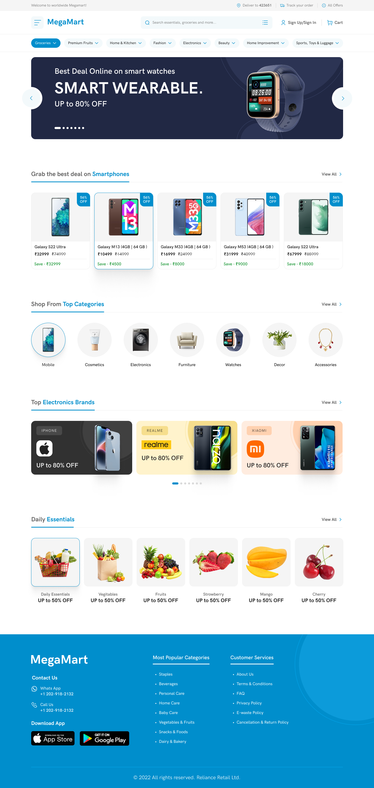

# VoltShop: e-commerce Angular pronto para agentes (WebMCP)



VoltShop é uma loja de eletrônicos (smartphones, CPUs, GPUs, memória RAM e armazenamento) feita em **Angular 22** com SSR. A diferença dela está no público: além de pessoas, **agentes de IA também usam a loja**. A aplicação expõe suas capacidades como ferramentas **WebMCP**, e um agente rodando no navegador consegue buscar produtos, comparar especificações, consultar estoque, montar o carrinho e explorar os dados da loja sem fazer scraping do DOM nem simular cliques.

## O que é WebMCP

[WebMCP](https://github.com/webmachinelearning/webmcp) é uma proposta de padrão web que permite a uma página registrar **ferramentas** (nome, descrição, JSON Schema de entrada e uma função `execute`) para que agentes no navegador as chamem. É o [Model Context Protocol](https://modelcontextprotocol.io) aplicado à própria página: o agente age pela mesma sessão, cookies e regras de negócio do usuário logado, e não precisa de um servidor MCP separado.

No Angular 22 isso é nativo:

```ts
// src/app/app.config.ts
provideExperimentalWebMcpTools([...STORE_TOOLS, ...DATA_TOOLS]),
```

Cada ferramenta é um `WebMcpToolDescriptor` e o `execute` roda em contexto de injeção. Por isso ela usa os mesmos serviços (`CatalogService`, `CartService`...) da interface, e o que o agente faz aparece na tela na hora (por exemplo, o contador do carrinho é atualizado via signals).

## Ferramentas expostas

### Loja (`src/app/core/webmcp/store-tools.ts`)

| Ferramenta | O que faz | Somente leitura |
|---|---|---|
| `search_products` | Busca no catálogo por texto livre, categoria (`phone`, `cpu`, `gpu`, `ram`, `storage`) e faixa de preço em USD | ✅ |
| `get_product` | Descrição completa e especificações técnicas de um produto | ✅ |
| `compare_products` | Compara de 2 a 4 produtos lado a lado, uma linha por spec, indicando onde os valores diferem | ✅ |
| `check_inventory` | Unidades em estoque de um produto | ✅ |
| `add_to_cart` | Adiciona uma quantidade ao carrinho do usuário. Falha se não houver estoque | ❌ |
| `view_cart` | Itens, quantidades, subtotais e total do carrinho (recarrega antes, pois o carrinho pode ter mudado em outra aba) | ✅ |

### Exploração de dados (`src/app/core/webmcp/data-tools.ts`)

Um mini "SQL somente leitura" em JSON, com tabelas virtuais sobre o catálogo e o carrinho: `products`, `product_specs`, `inventory` e `cart_items`.

| Ferramenta | O que faz |
|---|---|
| `list_tables` | Lista as tabelas com a contagem de linhas |
| `describe_table` | Colunas, tipos, chave primária e chaves estrangeiras de uma tabela |
| `get_table_relationships` | Relacionamentos entre tabelas. Não existe join, então o agente usa essas relações para encadear consultas |
| `preview_query` | Valida a consulta e devolve as 5 primeiras linhas e o total de resultados |
| `get_query_results` | Executa a consulta paginada (`limit` até 100, `offset`, `hasMore`) |

As consultas aceitam `columns`, `where` (combinados com AND, operadores `=`, `!=`, `<`, `<=`, `>`, `>=`, `contains`, `in`) e `orderBy`. A validação e a execução acontecem no backend (`POST /api/query`).

Exemplo de chamada que um agente faria:

```json
{
  "table": "products",
  "columns": ["id", "name", "price"],
  "where": [{ "column": "category", "op": "=", "value": "gpu" }, { "column": "price", "op": "<", "value": 800 }],
  "orderBy": { "column": "price", "direction": "asc" }
}
```

### Decisões de design

- **Entrada do agente não é confiável.** Cada ferramenta valida os próprios argumentos de novo em vez de confiar no `inputSchema`, e responde `{ "error": "..." }` com uma mensagem que o agente consegue usar para se corrigir.
- **`readOnlyHint`** marca todas as ferramentas sem efeito colateral. Só `add_to_cart` altera estado, e o agente (ou o navegador) pode pedir confirmação ao usuário antes de chamá-la.
- **Checkout fica com o humano.** Nenhuma ferramenta finaliza compra ou mexe em pedidos: o agente monta o carrinho e o usuário conclui em `/checkout`.
- **Custo zero no bundle inicial.** `DataTablesService` e `CompareService` são carregados com `injectAsync` + `import()` apenas quando um agente chama a ferramenta, então ficam em chunks lazy.
- **Saídas enxutas.** `search_products` devolve só os campos que o agente precisa para decidir (id, nome, marca, categoria, preço e estoque). O detalhe completo vem de `get_product`.

## A loja (interface humana)

| Rota | Página |
|---|---|
| `/` | Home com carrossel de destaques |
| `/products` | Catálogo com busca e filtros |
| `/products/:id` | Detalhe do produto e tabela de especificações |
| `/compare` | Comparação lado a lado |
| `/cart` | Carrinho |
| `/checkout` | Finalização do pedido |
| `/orders` | Pedidos realizados |

Stack: Angular 22 (standalone, signals, OnPush padrão, rotas lazy), Angular Material, SSR com hidratação incremental e event replay, testes com Vitest.

## Arquitetura

```
Navegador (pessoa ou agente WebMCP)
   │  /api/*  (mesma origem, cookie de sessão first-party)
   ▼
Servidor SSR Express (src/server.ts)  ──proxy──▶  Backend Go (API_ORIGIN, padrão http://localhost:8080)
```

- Em desenvolvimento, `ng serve` faz proxy de `/api` para `http://localhost:8080` (`proxy.conf.json`).
- Em produção, o servidor SSR encaminha `/api` para `API_ORIGIN`. No servidor, o token `API_ORIGIN` também transforma as URLs relativas em absolutas durante a renderização.
- O backend Go (catálogo, carrinho, checkout, pedidos e o motor de consultas `/api/tables` e `/api/query`) **não faz parte deste repositório** e precisa estar rodando.

## Como rodar

```bash
npm install
npm start          # http://localhost:4200, com o backend em http://localhost:8080
```

Build e SSR:

```bash
npm run build
API_ORIGIN=http://localhost:8080 npm run serve:ssr:ng-ai-improvements
```

Testes (incluindo os specs das ferramentas WebMCP):

```bash
npm test
```

## Testando com um agente

As ferramentas são registradas pela API WebMCP do navegador (`navigator.modelContext`). Para usá-las você precisa de um navegador ou extensão com suporte a WebMCP (a especificação ainda é experimental). Abra a loja, conecte o agente e peça algo como:

> "Encontre uma GPU abaixo de US$ 800, compare com as duas mais próximas e coloque a melhor no carrinho."

O agente vai encadear `search_products` → `compare_products` → `check_inventory` → `add_to_cart`, e o carrinho é atualizado na interface em tempo real.

## Estrutura

```
src/app/
├── app.config.ts          # providers, incluindo provideExperimentalWebMcpTools
├── core/
│   ├── webmcp/            # STORE_TOOLS e DATA_TOOLS (+ specs)
│   ├── services/          # Catalog, Cart, Compare, DataTables
│   ├── models/            # Product, Category, TABLE_NAMES, QUERY_OPS
│   └── layout/            # Shell, header com busca, footer
├── features/              # home, catalog, product-detail, compare, cart, checkout, orders
└── shared/                # ProductCard, SpecTable, StockLabel, SectionHeader
src/server.ts              # SSR Express + proxy /api
```
